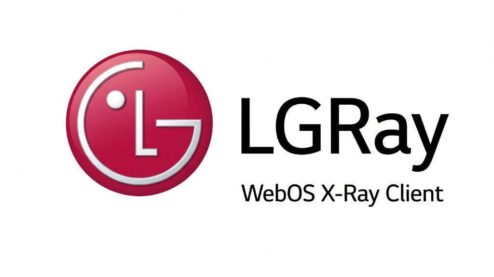

<div align="center">



# LGRay — WebOS X-Ray Client

[](https://webosbrew.org)
[](https://github.com/XTLS/Xray-core)
[](LICENSE)
[](#)

**LGRay** — современный, быстрый и удобный X-Ray / VLESS клиент для **LG Smart TV** на базе **webOS** (webOS 3.5, 4.x, 5.x, 6.x, webOS 22/23/24).
Работает на базе **Xray-core** (Linux ARMv7 / ARM64) с маршрутизацией через **TUN-интерфейс**, адаптивным интерфейсом для пультов LG Magic Remote и мгновенной передачей подписок со смартфона через QR-код.

</div>

---

## ⚡ Особенности и возможности

### 🚀 Протоколы и безопасность
- **VLESS Reality** с потоком `xtls-rprx-vision` и маскировкой SNI.
- Поддержка **VMess**, **Trojan**, **Shadowsocks**, **SOCKS5** и **HTTP**.
- **100% защита от DNS-утечек (Zero DNS Leak):** все запросы на порт 53 перехватываются внутренним `dns-out` и разрешаются внутри зашифрованного туннеля через Cloudflare/Google DNS.
- **Блокировка IPv6** для предотвращения утечек провайдеру.

### 🔀 Умные режимы маршрутизации
1. **Обход блокировок (РФ / Bypass RU — Рекомендуемый):**
   - Российские сервисы (Кинопоиск, Иви, Wink, Okko, Госуслуги, Сбербанк, Т-Банк, VK, Yandex, Mail.ru, `.ru`, `.su`) работают напрямую через домашнего провайдера на максимальной скорости без задержек.
   - Заблокированные и зарубежные ресурсы (YouTube, Google, Instagram, X/Twitter, Facebook, Rutracker и др.) направляются в зашифрованный туннель.
2. **Только YouTube и Google (YouTube Only):**
   - Специальный турбо-режим для ускорения YouTube: в туннель направляются только CDN и IP-пулы Google / YouTube. Все остальные ресурсы работают напрямую.
3. **Полный VPN (Global Proxy):**
   - 100% интернет-трафика операционной системы ТВ и приложений направляется через выбранный сервер.

### 📱 Мгновенная передача подписки с телефона (QR Sync)
- Забудьте про ввод длинных ссылок пультом на экранной клавиатуре!
- Откройте в приложении **«Импорт подписки со смартфона»** — на экране появится QR-код.
- Наведите камеру телефона, откроется веб-страница сопряжения (`api-lgray.dilim0n.ru`). Вставьте ссылку на подписку и нажмите **«Отправить на ТВ»** — телевизор мгновенно скачает подписку, распарсит все серверы и закроет окно.

### 📺 Управление Magic Remote (10-Foot UI)
- Полная поддержка **D-Pad стрелок** (Вверх, Вниз, Влево, Вправо, OK, Back) и аэромыши (курсора-указки).
- Логичный возврат в меню, быстрые переходы по группам кнопок, предсказуемая навигация.
- Кнопка **Back** на пульте корректно закрывает модальные окна без вылета из приложения.

### 🎨 Темы оформления и локализация
- **OLED (Черная):** 100% глубокий черный фон (`#000000`) для идеальной контрастности и экономии энергии на LG OLED панелях.
- **Темная (Dark):** стильный темно-серый минималистичный дизайн.
- **Светлая (Light):** высококонтрастный дневной режим.
- **Мультиязычность:** Русский (RU) и English (EN).

### ⏱ Фоновая работа и устойчивость
- Поддержка `handlesRelaunch` и `enableBackgroundRun` — при переключении на YouTube или онлайн-кинотеатры туннель не разрывается, а счетчик аптайма в LGRay идет непрерывно.
- Автозапуск службы при включении телевизора (через `/var/lib/webosbrew/init.d/10-xray.sh`).
- Автообновление подписок по расписанию (1 ч, 3 ч, 6 ч, 12 ч, 24 ч или вручную) с автоопределением интервала из заголовка `subscription-userinfo`.

---

## 📦 Установка на телевизор

### Вариант 1. Через Homebrew Channel (Рекомендуемый)
1. Убедитесь, что на ТВ установлен [Homebrew Channel](https://github.com/webosbrew/webos-homebrew-channel) с правами root.
2. Скачайте последний `.ipk` файл из раздела [Releases](../../releases).
3. Установите IPK через **Homebrew Channel -> Settings -> Install IPK** или через приложение **webOS Dev Manager** на ПК.

### Вариант 2. Быстрый деплой одной командой (через сеть)
Если на ТВ открыт порт Telnet (порт 23 в Homebrew Channel):
```bash
# 1. Собрать пакет IPK
python scripts/build-ipk.py

# 2. Установить на ТВ (укажите IP-адрес вашего ТВ)
node scripts/deploy-tv.js 192.168.0.15

# 3. Перезапустить приложение
node scripts/relaunch-tv.js
```

---

## 📂 Структура проекта

```
├── app/                        # webOS приложение (HTML5/JS/CSS)
│   ├── appinfo.json            # Манифест приложения webOS (id: org.webosbrew.xray)
│   ├── index.html              # Главный экран, дашборд и вкладки
│   ├── assets/                 # Иконки, логотип и баннер
│   │   ├── banner.png          # 16:9 промо-баннер приложения
│   │   └── logo.png            # Векторный/растровый логотип LGRay
│   ├── css/
│   │   └── style.css           # Адаптивные стили (rem/vw), темы (Dark, Light, OLED)
│   ├── js/
│   │   ├── app.js              # Главный контроллер UI и реактивного состояния
│   │   ├── bridge.js           # Luna elevated execution bridge и генератор конфигов Xray
│   │   ├── i18n.js             # Интернационализация (RU, EN)
│   │   └── spatial-nav.js      # Пространственная навигация пульта Magic Remote
│   ├── icon.png                # Иконка для лаунчера webOS (80x80)
│   └── icon-large.png          # Крупная иконка лаунчера webOS (130x130)
├── dist/                       # Собранные установочные пакеты
│   └── org.webosbrew.xray_1.0.0_all.ipk
├── worker/                     # Облачный бэкенд синхронизации (Cloudflare Worker + KV)
│   └── cloudflare-worker.js    # API сопряжения и передачи подписок по QR-коду
├── scripts/                    # Скрипты сборки и обслуживания
│   ├── build-ipk.py            # Автономный сборщик IPK пакетов (без webOS SDK)
│   ├── deploy-tv.js            # Автоматическая сетевая установка на ТВ по IP
│   ├── relaunch-tv.js          # Быстрый перезапуск приложения на ТВ
│   └── sync-sub-to-tv.js       # Прямая загрузка подписки на ТВ
├── LICENSE                     # Лицензия MIT
├── package.json
└── README.md
```

---

## ☁️ QR Sync Backend (Cloudflare Worker)

В директории [worker/](worker/) содержится код Cloudflare Worker для сервиса сопряжения:
- **Генерация 5-значных пин-кодов** для быстрого сопряжения.
- **Хранение сессий в Cloudflare KV** с автоматическим TTL 15 минут.
- **CORS и no-store заголовки** для мгновенного получения подписки телевизором без кэширования.

Развернуть собственный воркер можно в 1 клик через `wrangler deploy` в директории `worker/`.

---

## 🛡️ Безопасность и приватность

- Приложение **не содержит встроенных серверов или чужих ключей**.
- Приватные подписки хранятся строго локально на вашем телевизоре в защищенной директории `/var/lib/webosbrew/xray/client_config.json`.
- При передаче через QR-код сессия хранится в памяти Cloudflare KV не более 15 минут и удаляется сразу после получения телевизором.

---

## 📄 Лицензия

Проект распространяется под свободной лицензией **MIT**. Подробнее см. файл [LICENSE](LICENSE).
Xray-core распространяется под лицензией Mozilla Public License 2.0.
